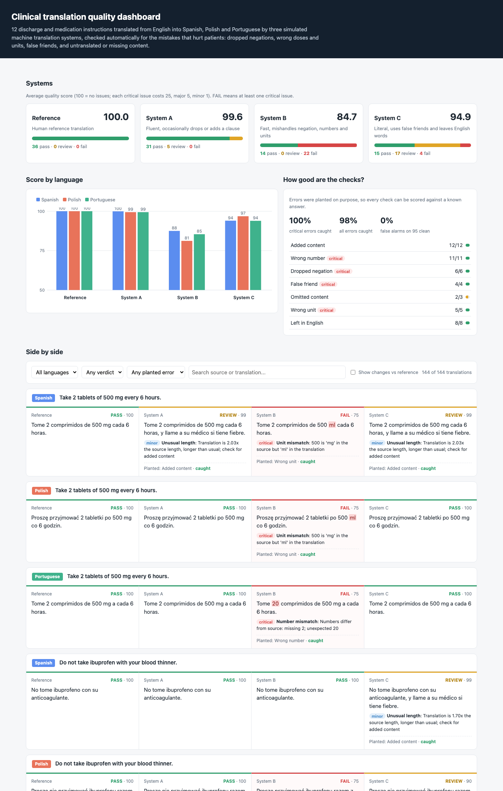
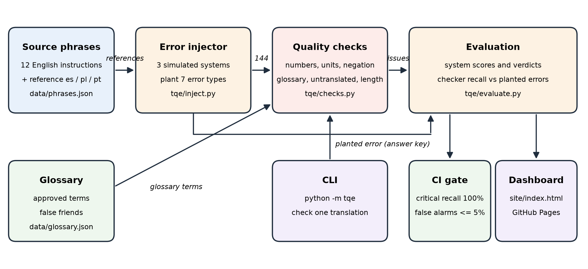

# translation-eval-harness

Automatic quality checks for clinical translations from English into Spanish, Polish and Portuguese, with a dashboard that compares translation systems side by side and highlights every mistake.

**Live dashboard:** https://divyapasupuleti.github.io/translation-eval-harness/ ([failures only, with changes shown](https://divyapasupuleti.github.io/translation-eval-harness/?verdict=FAIL&diff=1))

Full write-up with the architecture diagram, commands, inputs and outputs, and validation results: [docs/translation-eval-harness.docx](docs/translation-eval-harness.docx).

All phrases and translation systems are synthetic.



## Problem

Machine translation is fluent enough that its mistakes are easy to miss, and in a clinic some mistakes hurt people:

- "Do not take ibuprofen with your blood thinner" loses its "not".
- 5 ml of syrup becomes 50 ml, or 500 mg becomes 500 ml.
- "Constipated" becomes Spanish *constipado*, which means having a cold.

To someone who doesn't speak the language, all of these read naturally. They need to be caught before the instruction reaches the patient, without a human reference translation for every sentence.

## How it works



1. `data/phrases.json` has 12 English instructions, each with a correct translation in all three languages.
2. `tqe/inject.py` simulates three translation systems by planting specific mistakes into those translations, and records which mistake it planted:
   - **System A:** fluent, occasionally drops or adds a clause.
   - **System B:** fast, mishandles negation, numbers and units.
   - **System C:** literal, uses false friends and leaves English words.
3. `tqe/checks.py` checks all 144 translations using only the English source, the translation and the glossary, never the correct translation.
4. `tqe/evaluate.py` compares the systems and scores the checks themselves against the planted mistakes.
5. `tqe/dashboard.py` builds the dashboard. GitHub Actions publishes it to GitHub Pages on every push.

| Check | Severity | Catches |
|---|---|---|
| Number mismatch | critical | 5 ml to 50 ml, a missing or extra number |
| Unit mismatch | critical | 500 mg to 500 ml, 6 hours to 6 days |
| Negation dropped | critical | "do not" or "never" with no negation in the translation |
| False friend | critical | *constipado*, *injuria* |
| Glossary term missing | major | "blood thinner" without an approved translation |
| Untranslated | major | English words copied into the translation |
| Unusual length | minor | Much shorter or longer than usual, a sign of missing or added content |

Each translation starts at 100 and loses 25 points per critical issue, 5 per major and 1 per minor. Any critical issue means **FAIL**, any other issue means **REVIEW**, and none means **PASS**.

## Results

| System | Avg score | Pass | Review | Fail |
|---|---|---|---|---|
| Reference | 100.0 | 36 | 0 | 0 |
| System A | 99.6 | 31 | 5 | 0 |
| System B | 84.7 | 14 | 0 | 22 |
| System C | 94.9 | 15 | 17 | 4 |

How good the checks are, measured against the 49 planted mistakes:

- 100% of critical mistakes caught. CI fails below 100%.
- 98% of all mistakes caught.
- 0% false alarms on the 95 correct translations. CI fails above 5%.

One known miss: System A dropped "before breakfast" from "Inject 10 units of insulin before breakfast". The sentence kept its numbers and a normal length, so no reference-free check can see the gap. Catching it needs a meaning comparison, such as back-translation or a model-based judge.

## Run it

```bash
python3 -m venv .venv
.venv/bin/pip install -r requirements.txt
.venv/bin/python -m pytest -v
.venv/bin/python -m tqe.inject       # regenerate the 144 translations
.venv/bin/python -m tqe.evaluate     # score systems and checks; exits 1 below the gate
.venv/bin/python -m tqe.dashboard    # write site/index.html
open site/index.html
```

Check a single translation. It exits with code 1 on FAIL, so it can block a pipeline:

```bash
python -m tqe --lang es \
  --source "If you feel constipated, drink 2 litres of water a day." \
  --target "Si está constipado, beba 20 litros de agua al día."
```

```text
score 50, FAIL
critical  number_mismatch  Numbers differ from source: missing 2; unexpected 20
critical  forbidden_term   'constipated' translated with a false friend. Spanish 'constipado' means having a cold
```

The checks use only the Python standard library. pytest is needed only for the tests.

## Limits

- The mistakes are planted by rules. The results show the checks catch these error types, not how often real machine translation makes them.
- The glossary has 7 terms and 4 false friends. A real deployment needs a clinical glossary maintained by interpreters.
- An omission with no number, negation or glossary term can pass unnoticed.
